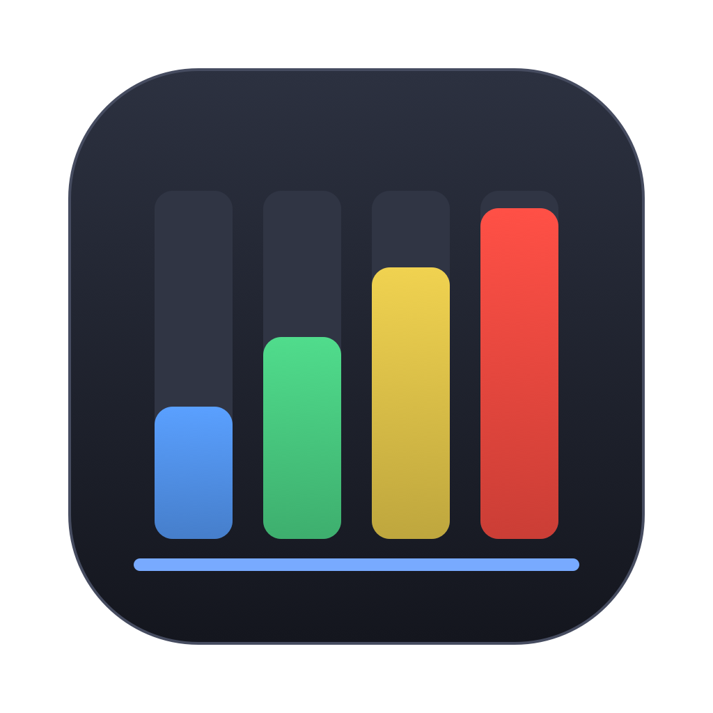
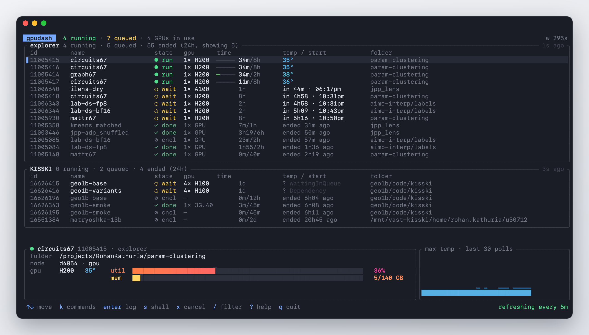
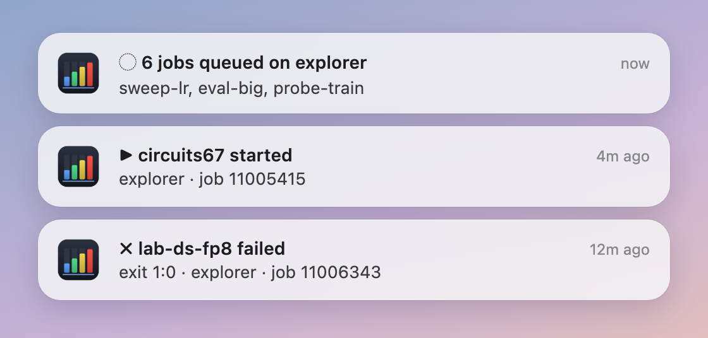
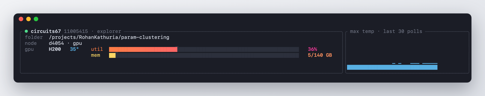
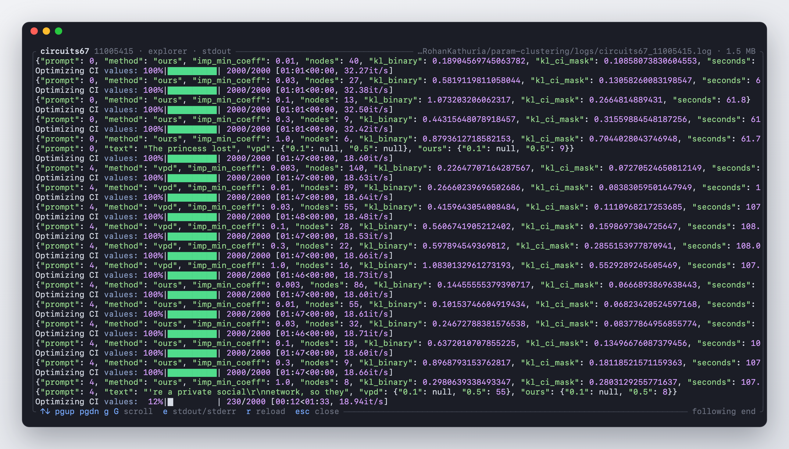
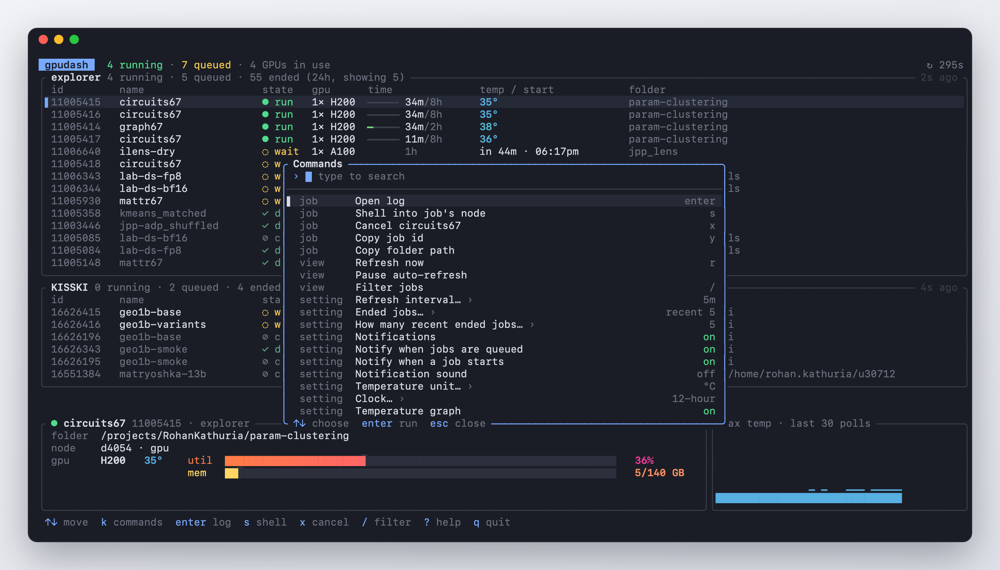

#  gpudash

**Keep track of lots of Slurm jobs, submitted by lots of agents, across all your clusters, from one terminal.**

When several agents (or sweeps, or teammates' scripts) are submitting jobs to several
clusters at once, you can't watch them all. gpudash shows every job on every cluster in one
live view, and your Mac tells you when jobs are queued, start, finish or fail.



## Features

### Every job, every cluster, one screen

Running, queued and recently ended jobs from all your clusters, refreshed every 30 seconds.
Queued jobs show Slurm's estimated start time, in your time zone. Ended jobs show how they
ended: `✓ done`, `✗ fail`, `✗ oom`, `⏱ time`, `⊘ cncl`.

### Notifications, so you don't have to watch



A notification when jobs are **queued**, **start**, **finish**, **fail**, run **out of
memory** or hit their **time limit**. When an agent submits a batch at once, you get one
notification ("6 jobs queued on explorer"), not six. Each kind can be turned off.

### Live GPU readings



Every running job shows each GPU's temperature (blue when cool, red when hot). The selected
job gets big usage and memory bars and a temperature graph.

### Logs in one keypress



`enter` opens the job's log: colored, scrollable, and following the end while the job runs.
It finds logs even after Slurm has forgotten the job.

### Command palette



`k` opens every action and setting in one searchable list. Changes are saved for next time.

### And

- `s` opens a shell **inside a running job**, on its GPU node.
- `x` cancels a job (asks first). `/` filters by name, folder or id.
- One shared ssh connection per cluster keeps refreshes quick. A cluster that stops
  answering shows an error and retries, and never freezes the screen.

## Install

You need [Rust](https://rustup.rs) and, on a Mac, Apple's Command Line Tools
(`xcode-select --install` if you don't have them).

```sh
cargo install --git https://github.com/RollingRo11/gpudash
```

On macOS this also builds a small notification app that puts the gpudash icon on
notifications. It's set up the first time a notification is sent; click **Allow** when
macOS asks.

## Setup

**1. ssh.** Each cluster needs a `Host` entry in `~/.ssh/config` that logs in without a
password. Check with `ssh -o BatchMode=yes mycluster true`.

**2. Clusters.** Start with one, then add the rest from inside the app (`k` → *Add cluster*):

```sh
gpudash explorer
```

gpudash saves them, so next time plain `gpudash` shows them all.

## Keys

| key           | action                                          |
| ------------- | ----------------------------------------------- |
| `k`           | command palette                                 |
| `↑` `↓` / `j` | move                                            |
| `enter`       | open the job's log (`e` stdout/stderr, `esc` back) |
| `s`           | shell into the job                              |
| `x`           | cancel the job                                  |
| `y`           | copy the job id                                 |
| `/`           | filter                                          |
| `h`           | ended jobs: recent → all from 24h → hidden      |
| `n`           | notifications on / off                          |
| `r`           | refresh now                                     |
| `?`           | all keys                                        |
| `q`           | quit                                            |

## Configuration

Settings live in `~/.config/gpudash/config.toml`. The command palette changes them for you;
these are the defaults:

```toml
refresh_seconds = 30
ended_jobs = "recent"       # "recent", "all" or "hidden"
recent_ended = 5
notifications = true
notify_on_queue = true
notify_on_start = true
notify_sound = false
temperature_unit = "C"      # or "F"
clock = "12h"               # or "24h"
temperature_graph = true

[[cluster]]
host = "explorer"           # ssh Host name
prefix = "/projects/me/"    # optional: hidden from the folder column
```

`gpudash mycluster` watches just that cluster; `gpudash -n 60` refreshes every 60 s this time.

## How it works

Each refresh sends one small script to each cluster's login node over ssh:

- `squeue` for active jobs, `sacct` for jobs that ended in the last 24 hours
- `srun --jobid=<id> --overlap nvidia-smi` inside each running job, to read its GPUs (no new
  resources used)

Notifications come from a tiny Swift app ([`notifier/main.swift`](notifier/main.swift)),
because macOS shows the Script Editor icon on anything sent with `osascript`.

## Requirements

- **Clusters:** Slurm 20.11 or newer, `nvidia-smi` on GPU nodes. Tested on Slurm 23.11 and 26.05.
- **Laptop:** macOS or Linux. Notifications and copying are macOS only.
- Only the first node of a multi-node job is read for GPU stats.

## License

MIT
