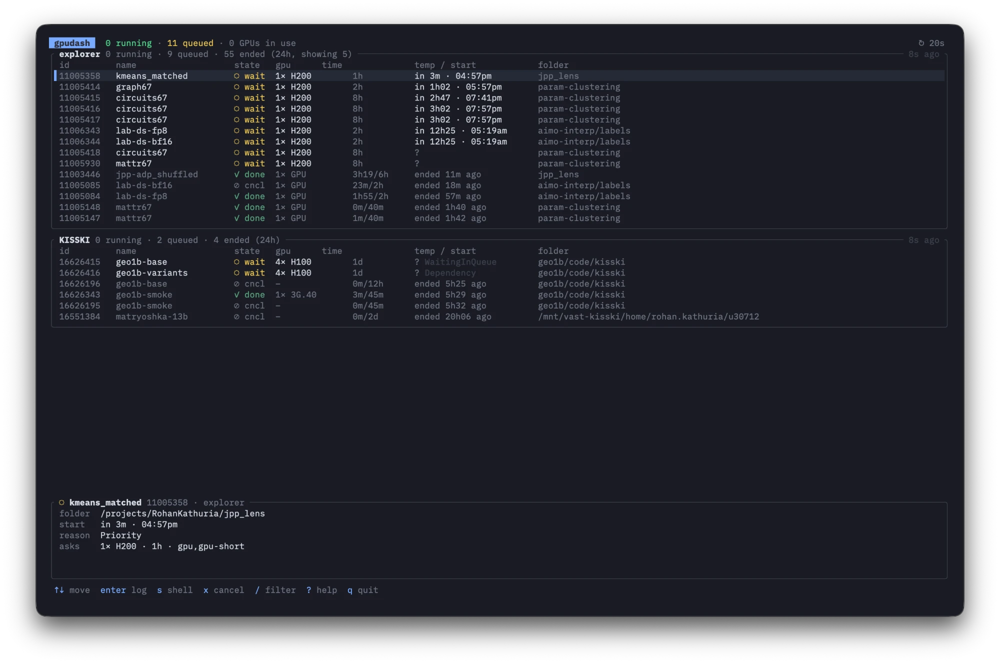

# gpudash

A live terminal dashboard for your Slurm jobs, across several clusters at once.

You run `gpudash` on your laptop. It logs into each cluster over ssh, asks Slurm what you
have running and queued, and reads the temperature of every GPU your jobs are on. Everything
shows up in one full-screen view that refreshes itself.



Running jobs also show each GPU's temperature, colored from blue (cool) through green and
yellow to red (hot), and a time bar that fills up and turns from green to red as the job
gets close to its time limit.

## What it shows

For every job:

| column           | meaning                                                                                       |
| ---------------- | --------------------------------------------------------------------------------------------- |
| **id**           | Slurm job id                                                                                  |
| **name**         | job name                                                                                      |
| **state**        | `● run`, `◌ wait`, or how it ended: `✓ done`, `✗ fail`, `✗ oom`, `⏱ time`, `⊘ cncl`            |
| **gpu**          | GPU type and count. For running jobs this comes from the actual card (`nvidia-smi`).          |
| **time**         | running: time used / time limit, with a bar. Queued: the time limit. Ended: time it ran.      |
| **temp / start** | running: temperature of each GPU. Queued: Slurm's estimated start. Ended: when, and exit code. |
| **folder**       | the folder the job was submitted from (with your configured prefix cut off)                   |

Start times and end times are in your laptop's time zone, in 12-hour time. If Slurm has no
start estimate you get `?`, plus the reason when it's something other than waiting in line
(for example `Dependency`).

The panel at the bottom shows more about the selected job: the full folder, the node, and,
for running jobs, each GPU's temperature, usage and memory, plus a small graph of temperature
over time.

Jobs that ended in the last 24 hours are listed after the active ones. By default you see
the 5 most recent per cluster; press `h` to see all of them, or none.

## Features

- **Logs** — `enter` opens the job's output log, full screen and scrollable. While the job
  is running it keeps updating and stays at the end. `e` switches between stdout and stderr.
  Logs are colored: if your program prints its own colors (rich, loguru, colored
  tracebacks…) you see those; otherwise gpudash highlights timestamps, log levels, errors and
  tracebacks, warnings, numbers, strings, paths, URLs, `key=value` pairs and progress bars.
- **Shell** — `s` drops you into a shell in the job's folder. If the job is running, the
  shell is *inside the job* on its GPU node (via `srun --overlap`), so `nvidia-smi`, `htop`,
  etc. show your job. Exit the shell to come back to the dashboard.
- **Cancel** — `x` cancels the job, after you confirm with `y`.
- **Filter** — `/` then type to show only jobs whose name, folder or id matches.
- **Notifications** (macOS) — a notification when a job starts, finishes, fails, runs out
  of memory or hits its time limit. `n` turns them off and on.
- **Copy** — `y` copies the job id.

## Install

You need [Rust](https://rustup.rs).

```sh
cargo install --git https://github.com/RollingRo11/gpudash
```

or from a clone:

```sh
git clone https://github.com/RollingRo11/gpudash
cd gpudash
cargo install --path .
```

This puts `gpudash` in `~/.cargo/bin`.

## Setup

### 1. ssh

gpudash logs in with plain `ssh <name>`, so every cluster needs an entry in `~/.ssh/config`
that works **without typing a password** (an ssh key). Check with:

```sh
ssh -o BatchMode=yes mycluster true
```

If that prints nothing and returns, you're good. Example entry:

```
Host explorer
    HostName login.explorer.northeastern.edu
    User myname
    IdentityFile ~/.ssh/id_ed25519
```

You don't have to set up connection sharing (`ControlMaster`) yourself. gpudash opens one
shared connection per cluster and keeps it alive for 10 minutes after the last use, so
refreshes don't log in from scratch every time.

### 2. Config file

Tell gpudash which clusters to watch in `~/.config/gpudash/clusters`
(or `$XDG_CONFIG_HOME/gpudash/clusters`):

```sh
mkdir -p ~/.config/gpudash
$EDITOR ~/.config/gpudash/clusters
```

One cluster per line:

```
# ssh name    folder prefix to hide (optional)
explorer      /projects/myname/
KISSKI        /mnt/vast-kisski/projects/myproject/
```

- **First column**: the `Host` name from your `~/.ssh/config`. It's also the title of
  the cluster's box.
- **Second column** (optional): a path prefix that gets cut off in the *folder* column, so
  `/projects/myname/experiments/run3` shows as `experiments/run3`. The full path is still in
  the detail panel.
- Anything after `#` is a comment. Blank lines are ignored.
- Clusters are shown in the order they're listed.

## Usage

```sh
gpudash                 # watch every cluster in the config file
gpudash explorer        # watch just one (uses its prefix from the config, if any)
gpudash -n 60           # refresh every 60 seconds instead of 30
gpudash --help
```

Without a config file you can still pass ssh names directly: `gpudash mycluster`.

### Keys

| key              | action                                              |
| ---------------- | --------------------------------------------------- |
| `↑` `↓` / `j` `k` | move                                                |
| `g` / `G`        | first / last job                                    |
| `enter` / `l`    | open the job's log                                  |
| `s`              | shell into the job (on its GPU node if running)     |
| `x`              | cancel the job (asks first)                         |
| `y`              | copy the job id                                     |
| `/`              | filter by name, folder or id (`esc` clears)         |
| `h`              | ended jobs: recent 5 → all from 24h → hidden        |
| `n`              | notifications on / off                              |
| `r`              | refresh now                                         |
| `?`              | show all keys                                       |
| `q` / `esc`      | quit                                                |

In the log view: `↑↓` `pgup` `pgdn` `g` `G` scroll, `e` switches stdout/stderr, `r` reloads,
`esc` closes.

## How it works

On each refresh, gpudash sends one small shell script to each cluster's login node over
ssh. It runs:

- `squeue` for your active jobs (state, times, GPUs, folder, estimated start) and their log paths
- `sacct` for jobs that ended in the last 24 hours
- `srun --jobid=<id> --overlap nvidia-smi …` for each running job, to read its GPUs. This
  runs inside your existing job, so it uses no new resources and only sees your job's GPUs.

The clusters are polled at the same time, and the screen keeps showing the last results
while a refresh is happening.

**Finding logs.** gpudash asks Slurm for the log path (`scontrol`, then `sacct`). Slurm
forgets about a job a few minutes after it ends, so gpudash also saves every log path it sees
in `~/.cache/gpudash/<cluster>.tsv`. If neither works (for example a job that ended before
you ever opened gpudash), it looks for a `.out` / `.log` / `.err` / `.txt` file with the
job id in its name, up to 3 folders deep in the job's folder.

## Requirements and limits

- **Clusters**: Slurm with `squeue`, `sacct` and `srun --overlap` (Slurm 20.11 or newer).
  GPU readings need `nvidia-smi` on the compute nodes. Tested on Slurm 23.11 and 26.05.
- **Your laptop**: macOS or Linux. Notifications (`osascript`) and copying (`pbcopy`) are
  macOS only; on Linux they quietly do nothing.
- Only the first node of a multi-node job is checked for GPU readings.
- Some clusters have a slow `squeue` (several seconds). That cluster's box will just update
  later than the others.

## License

MIT
